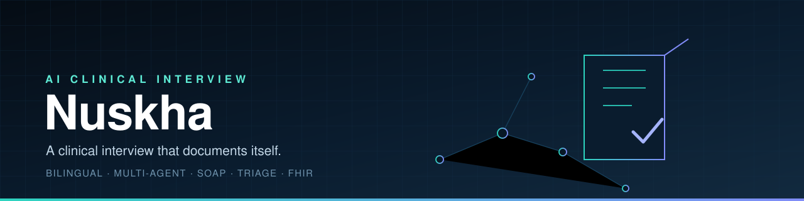
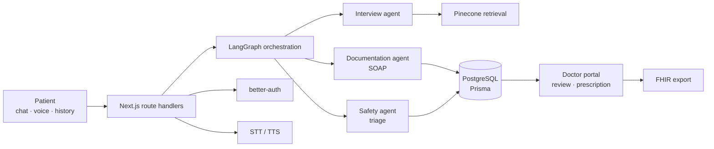

<div align="center">
  
</div>

<div align="center">

**A clinical interview that documents itself.**

[](https://github.com/SyedShah29/Nuskha/actions/workflows/ci.yml)
[](LICENSE)
[](https://nextjs.org/)
[](https://react.dev/)
[](https://www.postgresql.org/)

Designed and built by **Syed Hasaan Shah**.

</div>

---

Nuskha runs a structured clinical interview in Urdu or English, follows up on
answers like a clinician would, and turns the conversation into a SOAP report
that a doctor can review, edit, and sign off. A multi-agent LangGraph pipeline
separates interviewing, documentation, and safety so each stage has one job.

Patients get a guided intake, a medical history, and a documented session.
Doctors get a triage queue, the full report with evidence, and a review and
prescription workflow.

```text
intake → interview → red-flag check → SOAP report → doctor review → prescription
```

---

## Why Nuskha

- **Bilingual by design** — the full interview works in Urdu and English,
  including voice input and spoken responses.
- **Multi-agent, not one prompt** — interviewing, documentation, and safety are
  separate agents with separate responsibilities.
- **Documentation as a by-product** — SOAP notes are generated from the
  conversation, not typed afterwards.
- **Safety is a stage, not a hope** — guardrails and emergency checks run during
  the interview and before a report is released.
- **A real clinical workflow** — patient intake, doctor review, prescription,
  FHIR export, and follow-up chat around the report.
- **Retrieval-grounded** — medical knowledge is retrieved from a Pinecone index
  instead of relying on model memory.

---

## Features

### Patient experience
- Bilingual chat and voice interview (`app/patient/interview`).
- Guided medical history capture (`app/patient/profile`,
  `app/api/medical-history`).
- Live clinical chat with server-side orchestration
  (`app/api/clinical-chat/route.ts`).
- Speech-to-text and text-to-speech endpoints
  (`app/api/voice/stt`, `app/api/voice/tts`).
- Vision analysis endpoint for uploaded images
  (`app/api/vision-analyze`).
- Emergency hospital lookup by location
  (`app/api/emergency-hospitals`).
- Patient dashboard with session and report history
  (`app/api/patient/stats`).

### Clinical agents
- `lib/agents/` — LangGraph orchestration for interview, documentation, and
  safety.
- Interview agent with reasoning sub-agents and confidence tracking.
- Documentation agent that produces SOAP sections once the interview reaches
  completion confidence.
- Safety agent that labels triage severity and red flags.
- Guardrails that validate user input and constrain model output.
- Pinecone-backed retrieval for medical context.

### Doctor experience
- Doctor onboarding and profile management
  (`app/doctor/onboarding`, `app/doctor/profile`).
- Triage dashboard with patient and report statistics
  (`app/api/doctors/stats`).
- Full report review with evidence, editing, and approval
  (`app/doctor/report/[id]`).
- Prescription generation (`app/api/reports/[id]/prescription`).
- Report-scoped follow-up chat (`app/api/reports/[id]/chat`).
- FHIR export for interoperability (`app/api/reports/[id]/fhir`).
- Doctor directory and availability checks
  (`app/api/doctors`, `app/api/doctors/check`).

### Platform
- Authentication with better-auth (email/password and Google OAuth).
- Role-aware routing for patients and doctors (`app/api/user/role`).
- PostgreSQL with Prisma (`prisma/schema.prisma`).
- Document generation with jsPDF.
- Marketing site, documentation page, and not-found handling.

---

## Architecture



---

## Tech stack

| Layer | Technology |
| --- | --- |
| Framework | Next.js 16 (App Router), React 19, TypeScript 5 |
| Styling | Tailwind CSS 4, shadcn/ui, Radix, Motion |
| Auth | better-auth (email/password, Google OAuth) |
| Data | PostgreSQL, Prisma 7 |
| Agents | LangGraph, LangChain |
| Models | Groq, Google Gemini |
| Retrieval | Pinecone |
| Voice | ElevenLabs, speech-to-text and text-to-speech routes |
| Documents | jsPDF, FHIR resources |

---

## Quick start

```bash
git clone https://github.com/SyedShah29/Nuskha.git
cd Nuskha

npm install
cp .env.example .env        # fill database, auth, model, and voice keys
npx prisma generate
npx prisma db push
npm run dev                 # http://127.0.0.1:3000
```

Production:

```bash
npm run build
npm run start
```

### Environment

`.env.example` documents every key. The main groups are:

- `DATABASE_URL`, `DIRECT_URL` — PostgreSQL connections.
- `BETTER_AUTH_SECRET`, `BETTER_AUTH_URL` — session signing and base URL.
- `GOOGLE_CLIENT_ID`, `GOOGLE_CLIENT_SECRET` — Google sign-in.
- `GEMINI_API_KEY`, `GROQ_API_KEY` — model providers.
- `PINECONE_API_KEY`, `PINECONE_INDEX_NAME` — medical retrieval index.
- `ELEVENLABS_API_KEY` — voice synthesis.
- `LIVEKIT_API_KEY`, `LIVEKIT_API_SECRET`, `LIVEKIT_WS_URL` — realtime media.
- `NEXT_PUBLIC_APP_URL` — public application URL.

### Database

```bash
npx prisma generate
npx prisma db push
npx prisma studio
```

---

## API

```text
POST /api/clinical-chat            interview turn with agent orchestration
GET  /api/medical-history          patient history
GET  /api/patient/stats            patient dashboard metrics
POST /api/vision-analyze           image analysis
POST /api/voice/stt                speech to text
POST /api/voice/tts                text to speech
GET  /api/emergency-hospitals      nearby emergency facilities
GET  /api/doctors                  doctor directory
GET  /api/doctors/check            availability check
GET  /api/doctors/stats            doctor dashboard metrics
GET  /api/doctors/reports          assigned reports
GET  /api/reports                  report list
GET  /api/reports/{id}             full report
POST /api/reports/{id}/chat        report-scoped follow-up
GET  /api/reports/{id}/fhir        FHIR export
POST /api/reports/{id}/prescription generate a prescription
POST /api/reports/{id}/review      review decision
GET  /api/user/role                current role
POST /api/user/role                set role
```

---

## Project layout

```text
app/
├── (auth)/            login and signup
├── patient/           intake, interview, profile, dashboard
├── doctor/            onboarding, dashboard, report review, profile
├── api/               route handlers for chat, reports, voice, doctors, auth
├── docs/              in-app documentation
└── page.tsx           marketing site
components/            landing, auth, layout, shared, and UI components
lib/                   agents, auth, prisma, retrieval, and helpers
prisma/                schema and database configuration
```

---

## Author

Built end-to-end by **Syed Hasaan Shah**.

---

## License

Released under the [MIT License](LICENSE).
